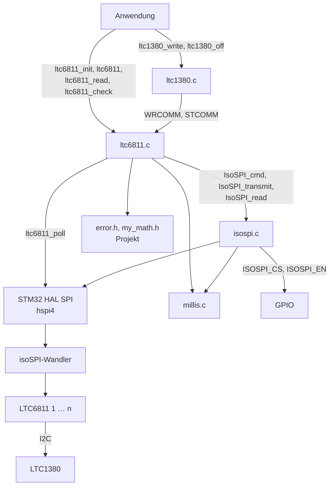
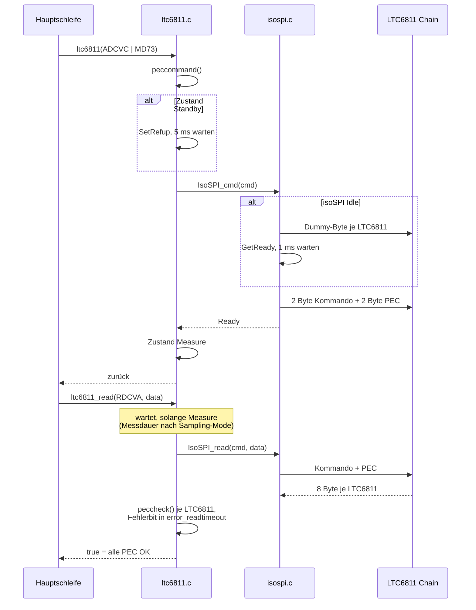
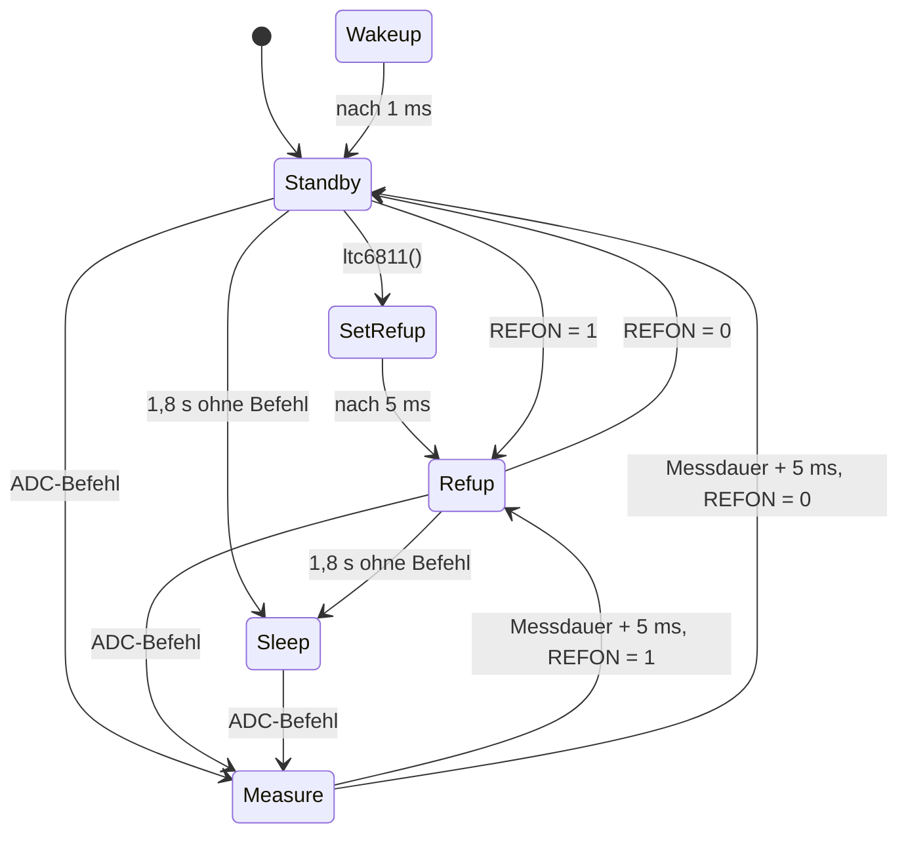
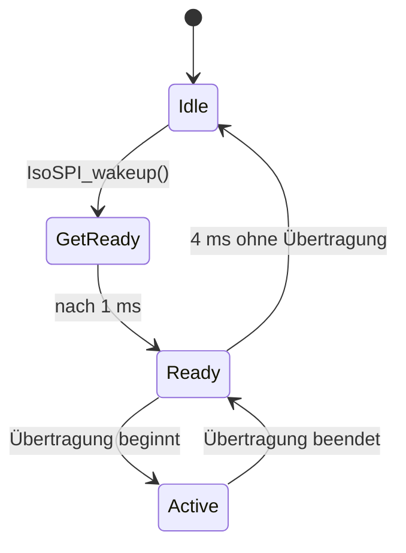

# Architektur STM32 LTC6811

Die Bibliothek besteht aus drei Schichten: `isospi.c` überträgt Bytes über SPI und den isoSPI-Wandler, `ltc6811.c` baut daraus Befehle mit PEC für die LTC6811 im Daisy-Chain, und `ltc1380.c` nutzt den I2C-Master der LTC6811, um die LTC1380-Multiplexer zu schalten. Zwei Statemaschinen, eine je Schicht, merken sich, ob isoSPI-Strecke und LTC6811 wach sind und ob eine Messung läuft. Alles läuft blockierend in der Hauptschleife.

## Komponenten

| Modul | Datei(en) | Aufgabe |
|-------|-----------|---------|
| LTC6811 | `ltc6811.c`, `ltc6811.h` | Kommandos mit PEC bauen, Daten prüfen, Statemaschine des LTC6811, Initialisierung, Diagnose, Balancing |
| isoSPI | `isospi.c`, `isospi.h` | Chip-Select, Wecken der isoSPI-Strecke, Senden und Empfangen über `hspi4`, Statemaschine der Strecke |
| LTC1380 | `ltc1380.c`, `ltc1380.h` | I2C-Telegramme für die LTC1380 in das Communication-Register schreiben und mit `STCOMM` senden |
| Zeitbasis | `millis.h` ([STM32_Millis](https://github.com/Diveturtle93/STM32_Millis)) | Millisekunden für Aufwach-, Referenz- und Messzeiten |
| Fehler und Mathematik | `error.h`, `my_math.h` (Projekt) | Fehlerausgabe bei fehlgeschlagener Initialisierung, Differenz zweier Messwerte |
| Peripherie | `spi.h` (CubeMX), STM32 HAL | SPI4 und die GPIOs für Chip-Select und Enable |

`ltc6811.c` und `isospi.c` binden sich gegenseitig ein: `isospi.c` braucht `LTC6811_DEVICES` und `STCOMM` aus `ltc6811.h`, `ltc6811.c` die Übertragungsfunktionen und Chip-Select-Makros aus `isospi.h`. Nur `ltc6811_poll()` greift an `isospi.c` vorbei direkt auf `hspi4` zu, weil sie nach dem Kommando byteweise auf das Ende der Wandlung wartet.

## Datenfluss

### Messung

Schreibende Befehle (`ltc6811_write()`) hängen an jede 6-Byte-Gruppe die PEC an und senden alle Gruppen in einem Chip-Select-Zyklus. Bei `STCOMM` sendet `IsoSPI_cmd()` nach dem Kommando 9 Byte je LTC6811, damit der LTC6811 die Takte für die I2C-Übertragung zum LTC1380 bekommt.

### Zustände LTC6811

Die Messdauer hängt von Sampling-Mode und `ADCOPT` ab und reicht von 2 ms (`MD2714`) bis 269 ms (`MD262` mit `ADCOPT = 0`). `Wakeup` und `ExtendedBalancing` sind definiert, werden aber noch von keiner Funktion gesetzt.

### Zustände isoSPI

Solange die Strecke `Ready` ist, wird vor einem Befehl nicht erneut geweckt. `Sleep` ist definiert, wird aber nicht gesetzt.

## Speicher und Ressourcen

| Ressource | Belegung |
|-----------|----------|
| Flash | `pec15Table`, 256 × `uint16_t` = 512 Byte |
| RAM statisch | `ltc6811_Conf` (4 Byte), `ltc6811_balance` (2 Byte je LTC6811), Zustände und Zeitstempel beider Statemaschinen |
| Stack | Puffer wachsen mit `LTC6811_DEVICES`: `ltc6811_validate_balance()` etwa 100 Byte, `ltc6811_openwire()` etwa 90 Byte und `ltc6811_test()` 64 Byte je LTC6811 |
| Peripherie | SPI4 (`hspi4`), zwei GPIO-Ausgänge `ISOSPI_CS` und `ISOSPI_EN` |
| Interrupts | keine eigenen, nur SysTick für `millis()` |

## Nebenläufigkeit

Die Bibliothek hat keine Interrupt-Routinen und benutzt kein DMA. Alle Funktionen laufen in der Hauptschleife und warten aktiv: auf die Statemaschinen über `millis()`, auf die SPI-Übertragung über die blockierenden HAL-Aufrufe und in der Diagnose über `HAL_Delay()`.

Die Statemaschinen werden nicht zyklisch aufgerufen. `get_ltc6811_state()` und `get_IsoSpiState()` werten sie bei jeder Abfrage aus, Zeitübergänge werden also erst beim nächsten Aufruf erkannt. Das reicht, weil die Bibliothek den Zustand vor jeder Übertragung abfragt.

Zustände, Konfiguration und Balancing-Register sind globale Variablen ohne Schutz. Die Funktionen dürfen deshalb nicht aus einem Interrupt oder aus mehreren RTOS-Tasks aufgerufen werden.

## Erweiterung

### Neuer LTC6811-Befehl

1. Kommando in `ltc6811.h` im passenden Abschnitt unter `Command Codes definieren` eintragen.
2. Befehle ohne Daten mit `ltc6811()`, schreibende mit `ltc6811_write()`, lesende mit `ltc6811_read()` senden.
3. Startet der Befehl eine ADC-Wandlung, muss er in `ltc6811()` die Statemaschine auf `LTCMeasure` setzen, damit `ltc6811_read()` auf das Ergebnis wartet.

### Weitere LTC1380

`LTC1380_DEVICES` in `ltc1380.h` erhöhen. Die Adressen `LTC1380_MUX0` bis `LTC1380_MUX3` sind vorhanden, mehr als vier LTC1380 sind am I2C-Bus eines LTC6811 nicht adressierbar.

### Anderes SPI

`hspi4` steht in `isospi.c` und in `ltc6811_poll()`. Beide Stellen müssen auf das neue Handle umgestellt werden.
